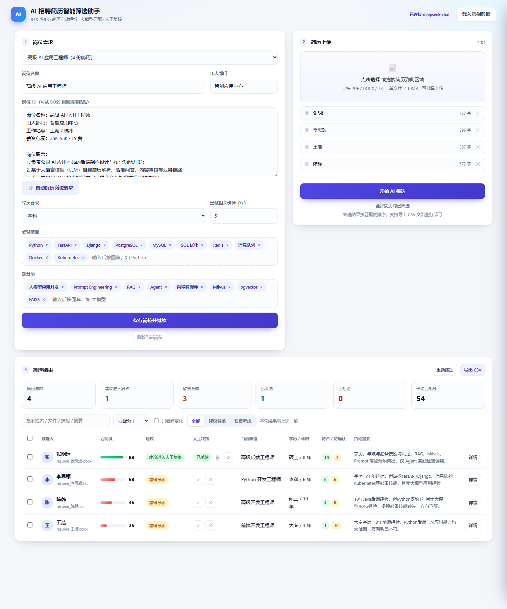
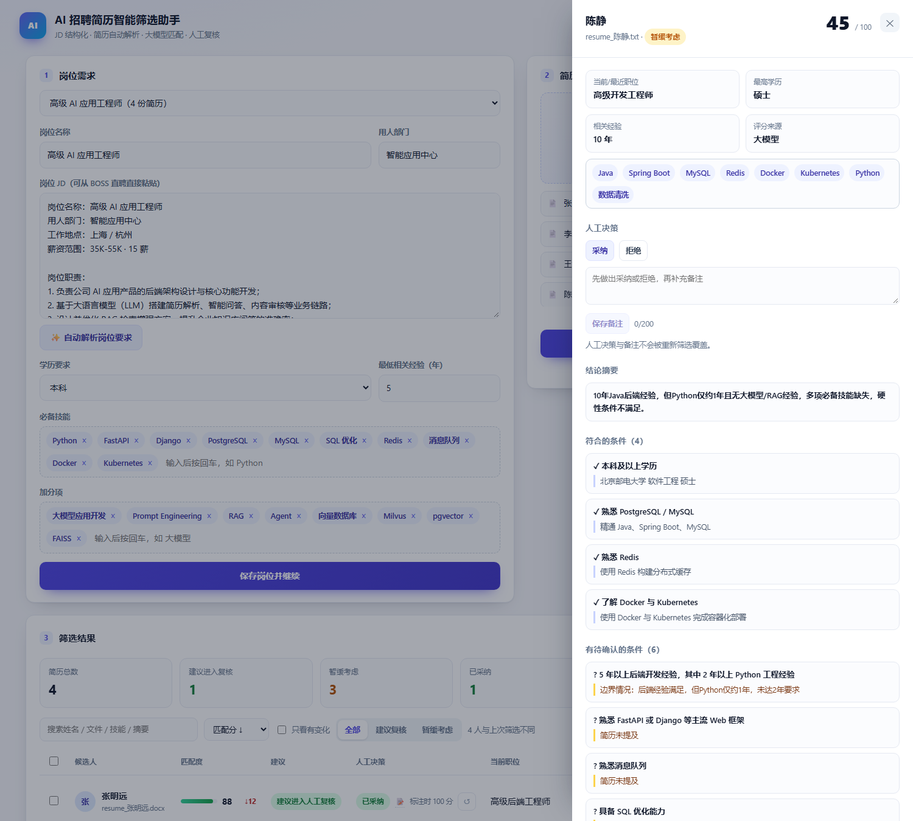
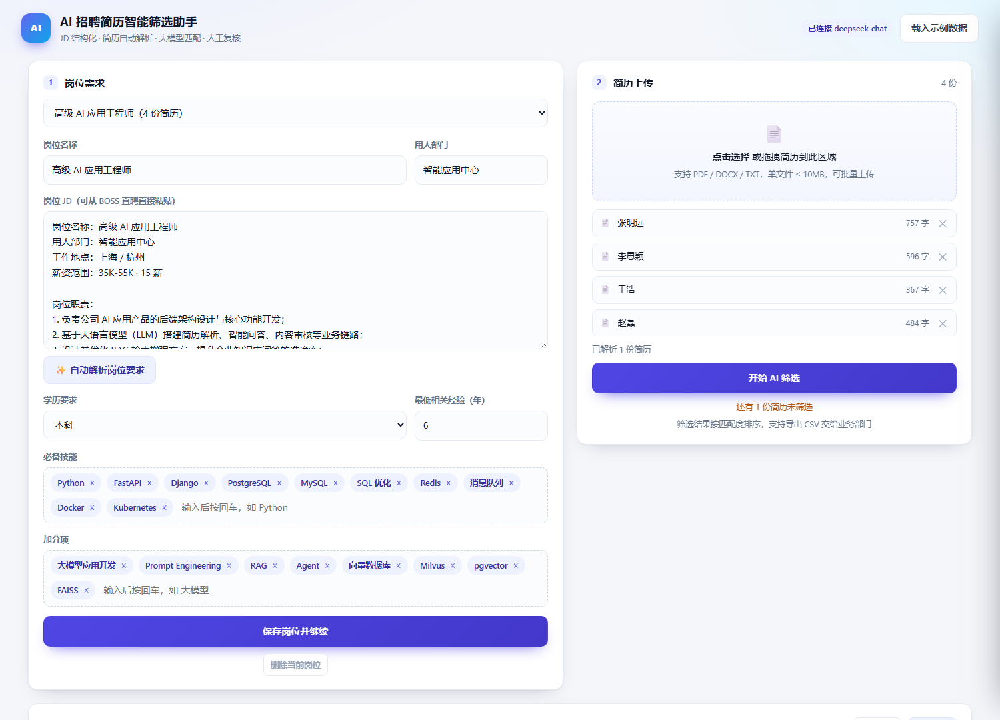

# AI 招聘简历智能筛选助手

> 面向 HR 招聘初筛场景的 AI 自动化 Demo：**粘贴 JD → 批量上传简历 → 大模型逐份匹配 → 输出可复核的排序结果**。



---

## 一、业务背景与方案边界

HR 在 BOSS 直聘上的初筛工作有三个重复动作：读 JD、逐份读简历、按条件做判断。数量一多，耗时和标准一致性都会出问题。

这个 Demo 只做**初筛建议**，不做自动淘汰：

- AI 输出「匹配分 + 理由 + 证据 + 待确认项 + 建议（复核 / 暂缓）」；
- 每一条「符合」都必须给简历原文证据，找不到证据的只能进「待确认」；
- 最终由 HR 判断，系统不自动发拒信、不自动标记候选人。

明确不做的事：不爬取 BOSS 直聘（合规与反爬原因），简历由 HR 下载后上传。

---

## 二、需求对照

| 原始需求 | 实现方式 | 位置 |
| --- | --- | --- |
| 1. 岗位需求输入 | 粘贴 JD 全文，一键自动抽取岗位名/部门/学历/年限/必备技能/加分项，可手动微调 | `POST /api/parse-jd`、`app/analyzer.py` |
| 2. 简历自动解析 | 支持 PDF / DOCX / TXT 批量上传，提取纯文本并猜测姓名；能区分文本型 PDF 与扫描件（扫描件给出处理建议）；三种格式都有样例与自动化测试 | `app/parsers.py`、`samples/` |
| 3. AI 智能匹配 | 大模型按固定 JSON 契约输出：匹配分、理由、符合项（带原文证据）、待确认项、优势、风险、建议 | `app/analyzer.py`、`app/prompts.py` |
| 4. 结果可视化 | 网页表格（分数条 / 建议徽标 / 统计卡片）、详情侧栏、按建议筛选、导出 CSV | `static/`、`GET /api/jobs/{id}/export.csv` |
| 5. 人工复核闭环 | 列表内一键「采纳 / 拒绝」、批量标注、判断备注；改 JD 后旧结果标记过期但标注不丢；重新筛选时标注与备注继续保留 | `PATCH /api/results/{id}/decision`、`app/db.py` |
| 6. 复核工作台 | 搜索、四种排序、只看有变化、键盘操作（↑↓ / A / R / X / Enter）、重筛后分数变化对比、重复简历拦截 | `static/app.js`、`scripts/capture_workbench.mjs` |

---

## 三、快速开始

环境要求：Python 3.10+（已在 3.12 验证）。

```powershell
# 方式一：一键启动（首次会自动建虚拟环境、装依赖、生成 .env）
.\run.ps1
# 或双击 start.bat

# 方式二：手动
python -m venv .venv
.\.venv\Scripts\python.exe -m pip install -r requirements.txt
Copy-Item .env.example .env
.\.venv\Scripts\python.exe -m uvicorn app.main:app --host 127.0.0.1 --port 8000
```

打开 <http://127.0.0.1:8000>，点击右上角**「载入示例数据」**，即可看到 1 份示例 JD + 4 份简历的完整筛选结果。

`samples/extra/` 下另有一份 PDF 简历（赵磊），不会被自动载入，需要演示 PDF 解析时手动上传。

### Docker 部署

```bash
docker build -t hr-screening .
docker run --rm -p 8000:8000 \
  -e DEEPSEEK_API_KEY=sk-xxx \
  -v "$(pwd)/data:/app/data" \
  hr-screening
```

`data/` 必须挂载为卷，否则容器重建会丢 SQLite 数据库；密钥通过环境变量传入，不写进镜像。

---

## 四、两种 AI 模式

启动时读取 `.env` 里的 `DEEPSEEK_API_KEY`，自动决定运行模式，页面右上角有徽标提示：

| 模式 | 触发条件 | 行为 |
| --- | --- | --- |
| `deepseek` | 配置了 API Key | 调用 `deepseek-chat` 做语义匹配，能理解「正在自学」「仅了解」这类语境 |
| `rule` | 未配置 Key | 内置规则引擎（学历/年限/技能关键词加权），保证无 Key 也能完整演示 |
| `rule-fallback` | 单份简历调用失败 | 自动降级到规则引擎，该份结果在详情里标注来源，不影响整批 |

配置真实大模型：

```ini
# .env
DEEPSEEK_API_KEY=sk-xxxxxxxx
DEEPSEEK_BASE_URL=https://api.deepseek.com
DEEPSEEK_MODEL=deepseek-chat
```

改完重启服务即可，页面徽标会变成「已配置 deepseek-chat」。

> 换成其他 OpenAI 兼容厂商（通义、Kimi、智谱、自建网关）只需改 `DEEPSEEK_BASE_URL` 与 `DEEPSEEK_MODEL`，代码无需改动。

### 历史对比：修复前同一岗位、同一批简历的差别

以下数值来自可信度修复前的演示，不代表当前代码输出或准确率。当前会对引用失效、硬条件待确认、年限冲突作保守处理，原有样例的日期与自述也可能冲突。

| 候选人 | 规则引擎 | DeepSeek | 差异原因 |
| --- | --- | --- | --- |
| 张明远 | 100 | **88** | AI 要求每条结论都有原文证据；Agent、pgvector 只出现在技能栏、没有项目佐证，被判为待确认并扣分 |
| 李思颖 | 67 | **58** | AI 点名缺 FastAPI/Django、消息队列、Kubernetes，而不是笼统的「部分必备技能未覆盖」 |
| 陈静 | 70 | **45** | 规则引擎命中了 Python/Redis/Docker 关键词；AI 读懂了「Python 仅约 1 年」「明确未接触大模型」，直接判定硬性条件不满足 |
| 王浩 | 15 | **25** | 两边都判定方向不符，但 AI 仍给了少量可迁移能力的分数 |
| 平均分 | 63 | **54** | |

建议人数一致（都是 1 人建议复核、3 人暂缓），但排序不同：规则模式下陈静高于李思颖，AI 模式下李思颖高于陈静，差别在**陈静被规则引擎高估了 25 分**——她恰好是那种「关键词都对、但语义不对」的候选人，也是人工初筛最容易误判的类型。这就是规则模式只能当兜底、不能当生产方案的原因。

历史速度参考：4 份简历、并发 3，曾耗时约 7 秒；单份 JD 解析约 1.6 秒。这是一次样例记录，没有进行性能基准测试。



---

## 五、3 分钟演示路径

1. 打开页面，将 `samples/credibility/jd_backend.txt` 粘贴到 JD 输入框，点击自动解析，查看 `FastAPI 或 Django` 与 `PostgreSQL 或 MySQL` 两个任选标签。
2. 保存岗位，上传 `samples/credibility/resume_测试甲.txt` 和 `resume_测试乙.txt`。两份均为明确标注的虚构候选人。
3. 查看“上传总数 2 / 已筛选数 0”，点击筛选。首次结果显示“首次筛选，无上次结果”。
4. 查看详情：引用完整回查、年限评估日期与依据。测试甲自述3年，闭合工作区间也是3年；测试乙自述8年与截至评估日期的工作区间冲突，应列为待确认。
5. 对测试甲进行人工采纳并写备注。将结构化最低经验改为20年，保留原JD中的3年并保存，演示结构化条件优先与旧结果过期提示。
6. 重筛后查看暂缓建议、保留的人工采纳和备注、标注时分数与变化。实际模型分数不预设，也不要求每次完全一致。
7. 导出CSV，包含人工决策、备注、年限依据、评估日期与一致性提醒。

原“一键载入示例数据”仍可使用，但不会覆盖已保存岗位或原有结果。旧样例按当前日期可能出现年限冲突；旧库不会自动重写旧结果，需重新解析并保存条件、重新筛选才能使用新口径。

修复后的浏览器验证、截图与真实模型样例结果见 [修复验证记录](docs/experience-2026-10-21/修复验证.md)。

---

## 六、设计说明

### 1. 分层，方便替换与测试

```
static/  →  app/main.py  →  analyzer.py  →  prompts.py
                               ↓              ↓
                          rule_engine.py   db.py (SQLite)
                               ↑
                          parsers.py
```

- `parsers.py` 只负责字节 → 文本，不掺业务判断；
- `analyzer.py` 只负责「给定 JD + 简历文本，产出一份结构化结果」，模型可替换；
- `rule_engine.py` 与 `analyzer.py` 输出同一份结构，前端无需区分模式。

### 2. 让模型「按格式说话」

所有分析结果走固定 JSON 契约（`app/prompts.py`），并做三层防御：

1. **提示词**里给出完整字段说明与取值约束；
2. **解析**时兼容 ```json 代码块包裹、前后夹带说明文字的情况；
3. **归一化**（`normalize_result`）兜住模型的不稳定输出：分数越界取整、`verdict` 同义词映射（"推荐"/"复核" → advance）、字符串数组自动补成结构化对象。

### 3. 提示词约束与原文核对

提示词写死了四条铁律，其中两条直接对应 HR 的复核需求：

- 每条「符合」必须逐字引用简历原文，找不到证据的要改放进「待确认」；
- 简历未提及的一律算「待确认」，不许当作符合，也不许当作不符合。

这也是为什么详情页每条符合项下面都有一行灰色引用 —— HR 可以立刻核对。

### 4. 引用定位、条件关系与保守复核

- 每条符合项的引用必须完整匹配，仅忽略空白和大小写；展示时恢复为实际定位到的原文。不再允许只匹配前12个字符，也不删除标点来容忍改写。
- **定位成功只证明原文存在，不证明该句足以支持岗位要求或经历真实**。语义相关性仍依赖模型分析与HR核实；这不是自动事实验证器。
- 引用失效后将条目移入待确认；为避免保留失效结论，本Demo对任一引用失效都保守处理：分数至多74、建议暂缓、改写摘要并展示提醒。这里是业务兜底规则，不是经过标注集校准的评分。
- verdict使用明确允许值，未知值和“不推荐”不当作推进；低于75分却推荐、暂缓却高分、硬条件仍待确认等不一致也会保守处理。
- 两种模式均支持一个标签中的任选关系：`FastAPI 或 Django`、`PostgreSQL 或 MySQL`。不同标签为同时要求。解析时将JD中明确的ASCII技术名任选写法合并；复杂嵌套条件不支持，请HR手动确认。`CI/CD`保持为技能名。
- **保存后的结构化学历、年限、技能条件优先于原JD**。原JD用于职责语境参考，重筛时不重新恢复HR已修改或删除的条件。旧岗位的平铺技能不会被后台静默改写，需重新解析和保存。
- 年限使用北京时间的评估日期。展示明确自述与“工作经历”区间合并去重后的总长；两者相差至少1年时视为口径冲突，相关年限显示待确认。没有明确自述也不把总任职时长直接当作相关经验。模型不得自行选择8年或9年来覆盖统一依据。
- 日期计算只识别明确的年/月区间及“至今”，不能判断每段工作的岗位相关性；多段自述取最大声明作为初筛参考，细分技能年限仍需人工核实。

新增依据与提醒保存在已有profile JSON中，旧库无需新增列；历史结果没有新依据时页面提示重新筛选。

### 5. 批量筛选的工程处理

- 并发受 `LLM_CONCURRENCY` 控制（默认 3），避免触发限流；
- 单份失败隔离：`asyncio.gather` 中某份异常只记错误，不中断整批；`save_result` 也包在 try 里，数据库异常同样降级为单份失败；
- **竞态防护**：分析耗时数秒，若期间简历被删除，写结果会违反外键约束。现在捕获 `IntegrityError` 并把该份记为「筛选过程中简历或岗位已被删除」，而不是让整批请求 500；前端在筛选期间也会禁用删除与上传。`scripts/check_concurrency.py` 可复现这个场景。
- 失败自动降级规则引擎，在模型调用失败且规则解析可用时仍提供规则结果。

### 6. 人工决策不会被重新筛选覆盖

这是 HR 真正用起来之后一定会撞上的问题：改一次 JD、点一次重新筛选，之前手工标的「这个要聊」「这个先放着」全没了，等于白干。

处理方式：

- **决策独立存储**：`results.decision` 记录采纳/拒绝，并额外保存 `decision_score`（标注当时的分数）；
- **重新筛选只更新判断，不碰决策**：`save_result` 的 upsert 只覆盖分数、理由、证据等 AI 产出字段，`decision` 三列不动；结果行 id 也保持不变，前端引用不会失效；
- **改 JD 不清空，改标记过期**：旧结果 `stale=1`，页面顶部出现黄色提示条与「立即重新筛选」按钮，行底色变黄，避免 HR 拿旧标准的结果做判断；
- **标注前后有对比**：如果重新筛选后分数发生变化，列表里会显示「标注时 100 分」，提示 AI 判断可能已经改变，值得再看一眼。

### 7. 复核工作台：减少重复操作

初筛只是开始，真正吃时间的是「看完并做决定」。这里增加搜索、批量标注和变化追踪来减少重复操作；尚未对400份简历进行并发或性能验证。

- **搜索 + 四种排序**：搜索覆盖姓名、文件名、技能、备注，找人说一句话就行；排序除了分数，还能「已标注优先」（回看已经决定过的人）和「有变化优先」。
- **批量标注**：勾选后一次处理一屏人，接口是 `PATCH /api/jobs/{id}/decisions`，SQL 带 `job_id` 条件，避免跨岗位误改（自测里专门验证了 `updated == 0`）。
- **键盘闭环**：`↑↓` 移行、`A` 采纳、`R` 拒绝、`X` 撤销、`Enter` 看详情。HR 一天标几百份时，鼠标位移才是主要成本；输入框聚焦或抽屉打开时快捷键自动让位。
- **变化追踪**：重新筛选时把旧分数写进 `previous_score`，列表用 `↑8 / ↓20` 标出变化，并可「只看有变化」。改完标准后，HR 需要复核的是变化的那几个人，而不是全部重看一遍。
- **简历去重**：按正文 SHA-256 指纹拦截同岗位重复投递，否则同一个人会被算两次、标两次，统计也不可信。旧库升级时会自动回填指纹。
- **未筛选的简历看得见**：上传后如果还有简历没跑过筛选，按钮下方会提示「还有 N 份简历未筛选」，避免 HR 以为漏了人。
- **备注**：判断依据（「期望薪资超预算」）比分数更有复用价值，导出时一并带走；列表里的快捷标注不会覆盖已写好的备注。



刻意不做的：多条件筛选器、自定义列、拖拽排序。这些在真实产品里需要，但会让 Demo 的界面复杂度超过它要证明的东西。

### 8. 数据模型

`jobs` → `resumes` → `results` 三张表，全部级联删除；`(job_id, resume_id)` 唯一约束让「重新筛选」变成幂等覆盖。SQLite 单文件，零部署成本，换 PostgreSQL 还需评估SQL、事务与迁移兼容性。旧库升级时 `init_db` 会自动补齐新增列，不需要手工迁移。

### 9. 前端

原生 HTML/CSS/JS，无构建步骤、无框架依赖。所有拼接内容统一走 `escapeHtml`，避免把简历文本或模型输出直接当 HTML 执行。

---

## 七、API 一览

| 方法 | 路径 | 说明 |
| --- | --- | --- |
| GET | `/api/status` | 当前 AI 模式与模型 |
| POST | `/api/parse-jd` | JD 文本 → 结构化条件 |
| GET/POST | `/api/jobs` | 岗位列表 / 新建岗位 |
| GET/PUT/DELETE | `/api/jobs/{id}` | 岗位详情 / 更新（标记旧结果过期并保留人工标注）/ 删除 |
| POST | `/api/jobs/{id}/resumes` | 批量上传简历（multipart，字段名 `files`） |
| GET/DELETE | `/api/resumes/{id}` | 简历原文 / 删除 |
| POST | `/api/jobs/{id}/screen` | 批量筛选（可选 `resume_ids`） |
| GET | `/api/jobs/{id}/results` | 排序后的结果列表 |
| GET | `/api/results/{id}` | 单份结果详情 |
| PATCH | `/api/results/{id}/decision` | 记录/撤销人工决策与备注（`accepted` / `rejected` / `null`） |
| PATCH | `/api/jobs/{id}/decisions` | 批量标注，只作用于本岗位的结果 |
| GET | `/api/jobs/{id}/stats` | total为上传总数，screened为已筛选数；含采纳/拒绝/变化数 |
| GET | `/api/jobs/{id}/export.csv` | 导出 CSV（UTF-8 BOM，Excel 直开不乱码） |
| POST | `/api/demo/seed` | 一键载入示例数据 |

交互式文档：<http://127.0.0.1:8000/docs>

---

## 八、测试

```powershell
# 规则模式端到端（47 项：上传/解析/筛选/排序/统计/导出/去重/批量标注/备注/变化追踪/级联删除）
.\.venv\Scripts\python.exe scripts\selftest.py

# AI 模式端到端（15 项：本地 mock OpenAI 兼容服务，含调用失败降级）
.\.venv\Scripts\python.exe scripts\selftest_ai.py

# 可信度回归（19个测试：合成异常输出、固定日期、临时库；不调用真实模型）
.\.venv\Scripts\python.exe scripts\selftest_credibility.py
```

其中 AI 模式测试用本地 mock 服务验证了：状态切换、JD 解析、筛选、结果归一化、证据字段、降级为 `rule-fallback`。
规则模式测试覆盖了完整的人工复核链路：标注并写备注 → 快捷标注不清空备注 → 批量标注 → 跨岗位隔离 → 改 JD 过期 → 重新筛选后标注/备注/标注时分数保留 → 上次分数记录 → 变化计数 → 重复简历拦截。

另有 `scripts/check_concurrency.py` 复现「筛选期间删除简历」的竞态，验证不会整批 500。

浏览器侧有两个脚本，用无头 Chrome + CDP 真实点击验证渲染与交互：`scripts/capture_decision.mjs`（标注与过期提示）、`scripts/capture_workbench.mjs`（批量、搜索、备注、重筛变化）。

---

## 九、目录结构

```
HRtest/
├── app/
│   ├── main.py          # FastAPI 路由
│   ├── config.py        # .env / 运行配置
│   ├── models.py        # Pydantic 数据契约
│   ├── db.py            # SQLite 持久化
│   ├── parsers.py       # PDF / DOCX / TXT 解析
│   ├── prompts.py       # 提示词与 JSON 契约
│   ├── analyzer.py      # DeepSeek 调用、归一化、降级
│   ├── rule_engine.py   # 规则兜底引擎
│   └── policies.py      # 共享条件表示、年限依据与保守处理
├── static/              # 前端（无构建）
├── samples/             # 示例 JD 与 4 份中文简历
├── scripts/             # 示例生成、自测、截图脚本
├── docs/                # 文档截图
├── openspec/            # 本次开发前的 OpenSpec 初始化产物
├── .env.example
├── requirements.txt
├── run.ps1 / start.bat  # 一键启动
└── README.md
```

---

## 十、已知限制与后续规划

**当前限制（都是有意为之的 Demo 取舍）**

- 不接 BOSS 直聘抓取，简历靠 HR 手动上传；
- 不支持旧版 `.doc`（会给出明确提示，请另存为 `.docx`）；
- 扫描件（图片型 PDF）无法直接读取内容，但**能识别出来**并提示「N/N 页只有图片、没有文字层」，建议让候选人提供原始 Word 或文本版 PDF，或先用 OCR 转换。这里没有内置 OCR —— 招聘场景里更省事的做法通常是让候选人重传；
- 规则模式是关键词匹配，会把「正在自学大模型」也算作命中，这正是需要 AI 模式的原因；
- **同一份简历重复评分可能有 ±5 分波动**：这是大模型的固有非确定性，`temperature=0` 也只能减小、不能消除。当时两轮AI样例中排序与判定保持一致（都是 1 人复核 / 3 人暂缓），该波动幅度只是两轮历史样例观察，不是稳定性上界；临界候选人及被一致性规则保守处理的结果需人工确认；生产环境可考虑「多次评分取中位数」或引入人工反馈校准，代价是调用成本上升；
- 人工决策记录的是「什么时候标了什么 + 一句备注」，没有操作人（无账号体系，也就没有审计日志）；
- 去重按简历正文完全一致判断，同一人换了排版或改了两个字会被当成新简历；
- 备注限 200 字纯文本，不支持附件或 @同事；
- 无账号体系与权限控制；简历原文默认本地存储，AI调用仍会发送原文到配置的模型服务。

**上生产的下一步**

1. 完全相同正文之外的候选人级去重，以及联系方式脱敏；
2. 扫描件 OCR，统一简历结构（工作经历按公司/时间拆段）；
3. 筛选标准可配置化（不同岗位用不同权重），并记录 HR 的「采纳/推翻」反馈回流成评估集；
4. 面试安排闭环：复核通过 → 生成面试问题清单 → 同步日历；
5. 权限、审计日志与数据加密。

---

## 十一、数据与合规

- 解析后的简历原文保存在本地SQLite（`data/hr_screening.db`）；使用AI模式时还会发往配置的模型服务。规则模式不调用模型接口。
- 调用模型时发送岗位名称、部门、结构化条件、JD全文、文件名、完整解析简历文本，以及统一年限依据。**当前未做自动脱敏**：原文中的姓名、电话、邮箱等信息可能随文本发送。请先获得适当授权或使用脱敏/虚构数据；不要把“本地存储”等同于“数据不出本机”。
- 生产环境建议：传输加密、按岗位隔离权限、定期清理、告知候选人并获得授权。

---

## 附：本次开发说明

项目在 OpenSpec 初始化的工作区中完成（`openspec/` 目录为初始化产物）。开发过程中通过 `scripts/selftest.py`、`scripts/selftest_ai.py` 与无头浏览器截图做了三轮验证：

1. 首轮自测暴露 4 个缺陷（姓名跨行提取、JD 年限未识别、技能误报、测试顺序错误），修复后全通过；
2. 截图检查发现「当前职位」被误识别为「姓名：张明远」、证据字段退化成「简历中出现 python」，修复后重新验证；
3. 用本地 mock 模型服务验证 AI 链路与降级，13 项全通过；
4. 第一版人工标注上线后，规则模式自测扩到 32 项，并用 CDP 验证「标注 → 改 JD → 过期 → 刷新后标注仍在」；
5. 第二轮把复核工作台补齐（批量、搜索、备注、变化追踪、去重、键盘），自测扩到 41 项；升级旧库时发现「新索引先于新列创建」导致启动失败，改为迁移后再建索引，并用旧数据库实测了字段迁移与指纹回填；
6. 接入真实 DeepSeek Key 后完整跑通：JD 解析 1.6s、4 份简历筛选 7.1s 全部成功，并逐条核对了证据引用与待确认项（确认没有编造原文）；两种模式的分数差异已记入上文对比表；
7. 收尾补了 PDF 解析验证（生成中文 PDF 样例并跑通解析，自测从 41 项扩到 45 项）、SQLite 的 WAL + busy_timeout（缓解锁竞争，仍可能超时或遇到写锁）、未筛选简历提示、岗位/简历删除确认、Docker 部署文件与 git 版本管理。
8. 后台日志暴露一个真实竞态：筛选进行中删除简历会让整批请求 500（外键约束）。修复后降级为单份失败并返回可读原因，前端在筛选期间禁用删除与上传；并补了 `scripts/check_concurrency.py` 专门复现这个场景——这类问题顺序测试永远覆盖不到，是真实操作（上传后立刻筛选、又顺手删掉一份）触发的。

以上开发轮次与截图均为历史记录。2026-10-21可信度修复保留了原演示库；旧分数不代表新算法输出。当前验证请查看修复验证记录。
